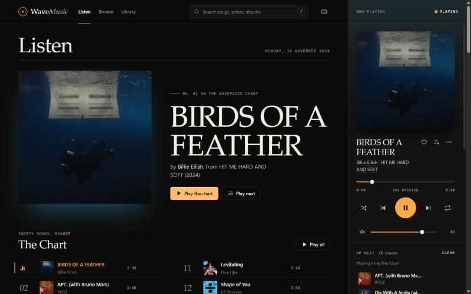
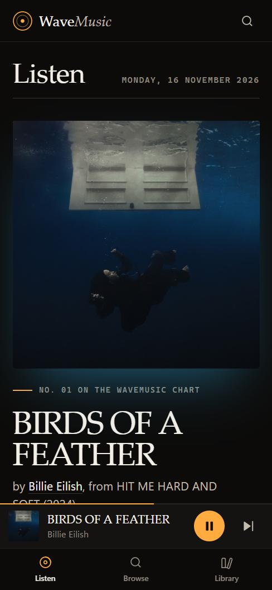
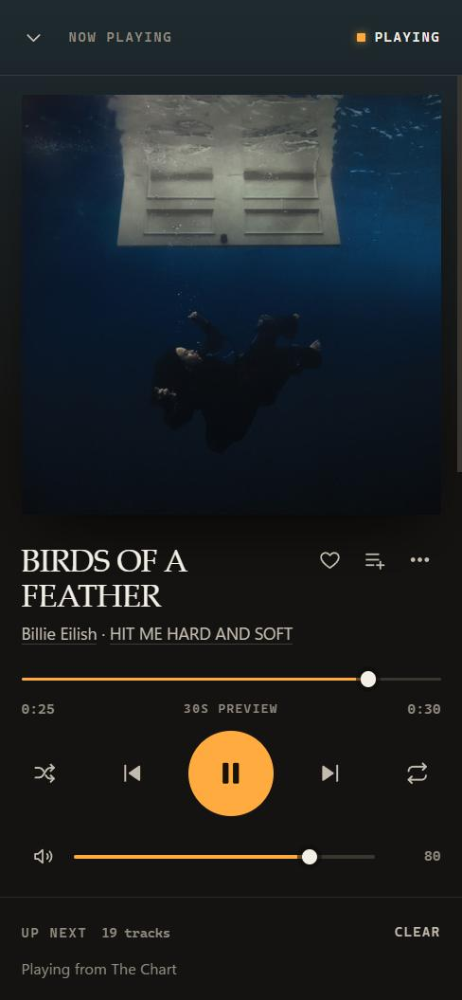

# WaveMusic

WaveMusic is a music listening web app built with plain HTML, CSS and JavaScript modules. It has no framework and no runtime dependencies. It plays the official 30-second previews of 63 real songs, with album artwork from Apple Music through the public iTunes Search API.

Version 2.0 is a full redesign. The look, called "Immersive Audio Experience", is led by artwork and set out like a magazine: large serif titles, a mono type for labels and a warm amber signal colour on near-black. The player is the centre of the app. On desktop it is a permanent "deck" column beside the content. On tablet and phone it is a mini bar that opens into a full-screen sheet.

[Live demo](https://hazell-lab.github.io/WaveMusic/) (serves whatever is on the `main` branch) · [Source](https://github.com/hazell-lab/WaveMusic)



<p>
  
  
</p>

---

## Contents

1. [Features](#features)
2. [Stack](#stack)
3. [Project structure](#project-structure)
4. [Install and run](#install-and-run)
5. [Build, preview and backup](#build-preview-and-backup)
6. [Tests](#tests)
7. [How audio works](#how-audio-works)
8. [Browser APIs used](#browser-apis-used)
9. [Keyboard shortcuts](#keyboard-shortcuts)
10. [Accessibility](#accessibility)
11. [Limitations](#limitations)
12. [Credits and copyright](#credits-and-copyright)

More detail on the decisions behind the redesign is in [IMPLEMENTATION.md](IMPLEMENTATION.md).

---

## Features

**Player**
- Play and pause, previous and next, a seek bar, elapsed and total time, volume, mute, shuffle and three repeat modes (off, all, one).
- Previous restarts the track if more than 3 seconds have played, as in most players.
- Shows the track, artist, album, artwork and a live status lamp: idle, loading, playing, paused or error.
- Remembers the queue, track, position, volume, shuffle and repeat. After a reload the session comes back paused, at the same position.
- If a preview fails, the player says so, shows a toast and moves on to the next playable track. It stops after one full pass, so it never loops on broken tracks.

**Queue**
- "Up next" list with play now, move up, move down and remove.
- Play next, add to queue and clear up next.
- Shuffle keeps the original order, so turning shuffle off puts the queue back the way it was.

**Library and playlists** (stored in this browser)
- Like songs and follow artists.
- Create, rename and delete your own playlists. You can add songs or whole albums, remove songs and reorder them.
- Save any curated collection or mix as your own playlist.
- Recently played history, which you can clear.
- Names are checked: they can't be empty, can't repeat and are capped at 60 characters. They are always shown escaped, so a name such as `<b>x</b>` is shown as plain text.

**Browse and search**
- Search across songs, albums, artists and collections. Matching ignores accents and case, so "rose" finds ROSÉ. Every word you type must match, and title matches rank above artist matches.
- Filter by result type and by genre. Ten genre pages.
- Clear states when there is nothing to show yet, no results (with a reset button), the catalogue is still loading, or it failed to load (with a retry button).

**Pages**
- Listen (home): the number 1 song, "pick up where you left off", The Chart (top 20), albums, singles, collections, mixes and an index of artists.
- Album, single, artist, collection, mix, genre, Library, Liked songs, Recently played and your own playlists.
- Share buttons use the system share sheet where one exists. Otherwise they copy the link.

---

## Stack

| | |
|---|---|
| Language | HTML, CSS and JavaScript (ES2022 modules) |
| Framework | None |
| Runtime dependencies | None. No CDN, no web fonts, no npm packages. |
| Dev dependencies | None. The scripts use Node's built-in modules only. |
| Tests | Node's built-in test runner (`node --test`) |
| Tooling | Node 20 or newer for the scripts and tests. The app itself is static files. |
| Data | iTunes Lookup API: one request for all 63 track ids, cached for 24 hours |

---

## Project structure

```
wavemusic/
├── index.html              app shell: masthead, view, player deck, mini player, tab bar, dialogs
├── css/
│   ├── base.css            design tokens, reset, buttons, ranges, artwork blocks, reduced motion
│   ├── layout.css          page grid, masthead, menus, dialog, toast, breakpoints
│   ├── player.css          deck, transport, queue, mini player, mobile sheet
│   └── views.css           page heads, feature, track lists, tiles, browse, library
├── js/
│   ├── main.js             wires everything together and handles all clicks in one place
│   ├── router.js           hash router (#home, #search, #album/<id>, ...)
│   ├── core/               store, storage, formatting and safe html helpers
│   ├── data/
│   │   ├── catalogue.js    songs, albums, artists, collections, genres and lookups
│   │   └── apple.js        loads previews and artwork from the iTunes API, with a cache
│   ├── player/
│   │   ├── audio-engine.js wraps the single <audio> element
│   │   ├── queue.js        pure queue functions (shuffle, step, move, remove)
│   │   ├── media-session.js lock screen and media key integration
│   │   └── player.js       the player controller and its state
│   ├── library/            likes, follows, playlists and history (pure functions plus a store)
│   ├── search/search.js    accent-insensitive weighted search
│   ├── ui/                 player ui, track lists, menus and dialogs, icons, artwork, keyboard
│   └── views/              one module per page
├── assets/
│   ├── images/             idle cover and app icon
│   └── playlists/<id>/     generated covers for collections and mixes
├── scripts/
│   ├── serve.js            static dev server
│   ├── build.js            copies the app to dist/ and checks every local reference
│   ├── build-art.js        regenerates the svg covers and icon
│   └── zip.js              writes a source backup zip
├── tests/                  unit tests and test helpers (fake audio element, memory storage)
└── docs/                   screenshots
```

---

## Install and run

You need [Node.js](https://nodejs.org) 20 or newer. There is nothing to install: the project has no dependencies, so `npm install` is not needed.

```bash
npm run dev
```

Then open http://localhost:5173.

The app uses ES modules, which browsers will not load from a `file://` address, so you can't open `index.html` by double-clicking it. Any static server works, for example VS Code Live Server or `python -m http.server`.

---

## Build, preview and backup

```bash
npm run build
```

This copies `index.html`, `css/`, `js/`, `assets/` and `LICENSE` into `dist/`. There is no bundling or minifying; the browser loads the modules as they are. The build then checks that every import, stylesheet, script, image and collection cover it references exists. If any do not, it fails and lists them.

```bash
npm run preview
```

This serves `dist/` at http://localhost:5174.

```bash
npm run zip
```

This writes `wavemusic-backup.zip` with the project source. It leaves out `.git`, `.claude`, `node_modules`, `dist`, caches, logs and other zip files.

```bash
npm run art
```

This regenerates the collection and mix covers, the idle cover and the app icon.

---

## Tests

```bash
npm test
```

50 unit tests run in Node with no browser and no dependencies. A small fake `<audio>` element and an in-memory storage stand in for the browser.

| File | What it covers |
|---|---|
| `queue.test.js` | shuffle keeps the current track first and can be undone; repeat modes; next and previous at the edges; insert, move and remove |
| `audio-engine.test.js` | status changes; a slow `play()` from an old track can't start a newer one; blocked autoplay; media errors; listener cleanup |
| `player.test.js` | play, pause and toggle; auto-skip of failed tracks with a stop after one pass; repeat one and all; restart versus previous; session save and paused restore; Media Session calls |
| `library.test.js` | likes, follows, playlist name rules, duplicates, reordering, history limits, cleaning bad stored data, migrating old likes |
| `search.test.js` | accent and case folding, ranking, filters, empty queries, and checks that every song points at a real album, artist and genre |
| `apple.test.js` | artwork sizing, applying API results and caching them, and a failed request turning into an error state |

The browser checks were done by hand. They are described in [IMPLEMENTATION.md](IMPLEMENTATION.md#browser-qa).

---

## How audio works

- There is one `<audio>` element for the whole app, so two songs can never play at once.
- Every load gets a token. Events and `play()` promises from an older load are ignored, so a slow network response can't start or show the wrong track.
- Blocked autoplay (`NotAllowedError`) leaves the player paused with the track ready, and a toast asks you to press play. This happens, for example, when a restored session tries to resume.
- Media errors (network, decode, unsupported source) set the error state and show a message, and the player skips to the next track that can play.
- The progress bar is updated with `requestAnimationFrame` only while audio is playing and the page is visible. It is drawn straight to the DOM, so playback never re-renders the page.
- The seek bar previews while you drag and seeks when you let go.
- The position is saved when you pause or change track, when the tab is hidden and when the page closes.
- The app waits for the catalogue (preview URLs) before it plays anything. Tracks that Apple doesn't return are marked unavailable and are skipped.

---

## Browser APIs used

| API | Used for |
|---|---|
| `HTMLAudioElement` | playback, seeking, volume and mute |
| Media Session | lock screen and notification metadata with artwork, play/pause/next/previous/seek handlers, playback state and position |
| Page Visibility (`visibilitychange`) | pausing the progress loop when the tab is hidden, saving the position |
| `localStorage` | session, library and API cache, all under the `wavemusic.` prefix. If storage is blocked or full, the app keeps working in memory for that visit. |
| `fetch` + `AbortController` | the catalogue request, with a 12-second timeout |
| `<dialog>` | modal dialogs with native focus trapping |
| `inert` | makes the page behind the mobile player sheet unreachable |
| Web Share / Clipboard | share buttons |
| `matchMedia` | sheet layout and `prefers-reduced-motion` |

---

## Keyboard shortcuts

Press `?` in the app to see this list.

| Key | Action |
|---|---|
| Space or K | Play or pause |
| Shift + → / Shift + ← | Next track / previous track or restart |
| → / ← | Seek forward or back 5 seconds |
| M | Mute or unmute |
| S | Shuffle on or off |
| R | Cycle repeat: off, all, one |
| Q | Open the player and queue |
| / | Search |
| ? | Show the shortcuts |
| Esc | Close menus, dialogs and the player sheet |

Shortcuts are ignored while you type in a field. They also leave keys alone that a focused control already uses, such as arrows on a slider or Space on a button.

---

## Accessibility

- There is a skip link. On every page change, focus moves to the new page's heading, so screen readers read it out. Track changes, shuffle and repeat are announced through a live region.
- All controls are real buttons or links, each with a label. Toggles use `aria-pressed`, the current navigation item uses `aria-current`, and sliders have value text such as "0:42 of 0:30".
- The track menu follows the ARIA menu pattern: arrow keys, Home, End and Esc work, and focus returns to the button that opened it.
- The playing track is marked with an equaliser icon and hidden text, not colour alone.
- Visible focus rings everywhere. Even the dimmest text colour measures at least 5.2:1 against the page backgrounds, above the WCAG AA minimum of 4.5:1.
- With `prefers-reduced-motion`, animations and transitions are turned off.

---

## Limitations

- **Previews only.** Apple's API provides 30-second previews. Full tracks are not available.
- **Needs the internet** for audio and artwork. If the catalogue can't load, the app says so and offers a retry. It doesn't pretend to play. The earlier version had an offline "demo mode" that faked progress; it was removed.
- **Fixed catalogue.** The 63 songs are listed in `js/data/catalogue.js`. Search covers only this catalogue, not all of Apple Music.
- **Data stays in one browser.** Likes, playlists and history live in `localStorage`. There are no accounts and no sync.
- **No artist photos.** The API does not provide them, so artist pages use album artwork with a caption saying which album it is.
- **Volume on iOS.** iOS ignores `audio.volume`, so the volume slider has no effect there. Mute still works.
- **Media Session** support differs between browsers. Metadata and handlers were checked in Chromium. Physical media keys and lock screens on phones were not tested.
- **Needs a web server.** The page has to be served over HTTP or HTTPS (see [Install and run](#install-and-run)).

---

## Credits and copyright

- Song previews, album artwork and Apple Music links come from Apple through the public iTunes Search API, and are streamed from Apple's servers. No audio or album artwork is stored in this repository.
- Songs, album titles and artist names belong to their artists and labels. This is a non-commercial portfolio project. Each artist page links to the artist on Apple Music.
- The WaveMusic mark, icons, colour palettes and the collection and mix covers are original. They are generated by `scripts/build-art.js` or drawn by hand as SVG in `js/ui/icons.js`.
- Fonts come from the system font stack (serif, sans and mono). No web fonts are downloaded.

**Licence:** the code is under the MIT licence (see [LICENSE](LICENSE)). The music previews and artwork are not covered by it; they belong to their rights holders.

---

## Author

Built by **Hazim Aqil**, Software Engineering student at the German-Malaysian Institute (GMI).

- Portfolio: [hazimaqil-portfolio.netlify.app](https://hazimaqil-portfolio.netlify.app)
- GitHub: [@hazell-lab](https://github.com/hazell-lab)
- LinkedIn: [mdhazimaqil](https://www.linkedin.com/in/mdhazimaqil/)
