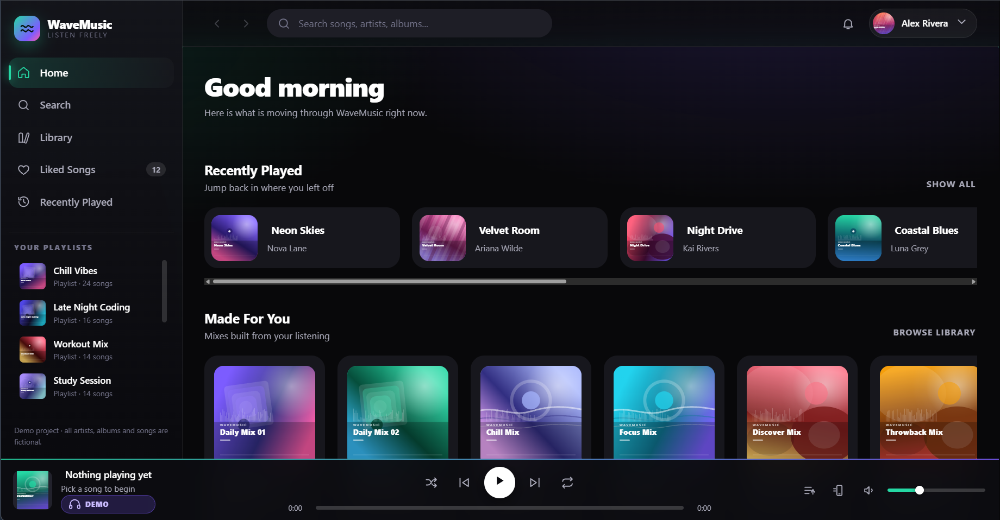

# WaveMusic

A **complete music streaming frontend** built with plain **HTML5, CSS3 and vanilla JavaScript** — no React, no Vue, no Bootstrap, no Tailwind, no build step, no npm install.

It is an **original design** inspired by the *feel* of modern music apps (dark theme, rounded cards, fixed bottom player, soft gradients) but it copies **no** branding, logos or layouts.

The catalogue is **63 real, popular songs** (The Weeknd, Billie Eilish, Taylor Swift, Coldplay, NewJeans, Yuna and more). Each one plays its **official 30-second preview** with real album artwork, loaded live from Apple Music through the free, public [iTunes Search API](https://performance-partners.apple.com/search-api). No audio or artwork files are stored in this repo.

Open `index.html` in a browser (or use VS Code Live Server) and you get a working music app: home feed, search, library, playlists, albums, artist pages, a queue, a Now Playing overlay and a fully working bottom player. If you're offline, a **demo mode** keeps everything interactive anyway.

**[🔗 Live Demo](https://hazell-lab.github.io/WaveMusic/)** · [Source code](https://github.com/hazell-lab/WaveMusic) · [Portfolio](https://hazimaqil-portfolio.netlify.app)



---

## Table of contents

1. [Project overview](#1-project-overview)
2. [Folder structure](#2-folder-structure)
3. [How to run it](#3-how-to-run-it)
4. [Features](#4-features)
5. [Where the music comes from](#5-where-the-music-comes-from)
6. [Artwork](#6-artwork)
7. [Customising the songs, artists and playlists](#7-customising-the-songs-artists-and-playlists)
8. [Changing the look (colours, fonts, branding)](#8-changing-the-look)
9. [How the code is organised](#9-how-the-code-is-organised)
10. [Responsive design notes](#10-responsive-design-notes)
11. [Accessibility & performance](#11-accessibility--performance)
12. [Optional developer tools](#12-optional-developer-tools)
13. [Copyright & credits for the music](#13-copyright--credits-for-the-music)
14. [Future improvements](#14-future-improvements)
15. [Credits](#15-credits)

---

## 1. Project overview

| | |
|---|---|
| **Name** | WaveMusic |
| **Type** | Frontend portfolio project (static site) |
| **Stack** | HTML5 · CSS3 · vanilla JavaScript (ES5/ES6, no frameworks) |
| **Build step** | None. Open the file and it runs. |
| **Dependencies** | None. No CDN, no npm packages, no external fonts required. |
| **Data source** | iTunes Search API (one `fetch()` on startup, cached for 24 hours) |
| **Works offline** | Yes, in demo mode: the UI works, previews and album art need internet. |
| **Author** | Muhamad Hazim Aqil — Diploma in Software Engineering, German-Malaysian Institute |

---

## 2. Folder structure

```
WaveMusic/
├── index.html                  # The whole app shell (sidebar, header, player, overlays)
├── README.md                   # This file
│
├── css/
│   └── style.css               # All styling: variables, layout, components, responsive
│
├── js/
│   ├── data.js                 # ⭐ ALL the content: songs, artists, albums, playlists, palettes
│   ├── app.js                  # ⭐ The app: views, router, player logic, event handling
│   ├── art.js                  # Cover-art helpers + the broken-image fallback
│   └── icons.js                # The SVG icon sprite (59 hand-written icons)
│
├── assets/
│   ├── images/
│   │   ├── avatar.svg          # Profile picture placeholder
│   │   ├── default-cover.svg   # Fallback "nothing playing" artwork
│   │   └── app-icon.svg        # Favicon / app icon
│   │
│   └── playlists/              # Generated covers for the 9 playlists + 6 mixes
│       ├── chill-vibes/cover.svg
│       └── ...
│
└── docs/                       # Optional tools — the website does not need these
    ├── build-art.js            # Regenerates the 18 playlist, mix and app covers
    └── verify-logic.js         # Runs the real app code in Node and asserts 95 behaviours
```

Album art and audio are not in the repo: they are streamed from Apple Music when the app runs.

---

## 3. How to run it

### Option A — just open it (fastest)

Double-click `index.html`. That is it. The app works from `file://`.

> Note: when you open the page directly from disk, some browsers block `localStorage`. That only affects remembering your likes/volume between visits — everything else works normally.

### Option B — VS Code Live Server (recommended)

1. Install **Visual Studio Code**.
2. Install the extension **Live Server** (by Ritwick Dey).
3. Open the `wavemusic` folder in VS Code: `File → Open Folder…`
4. Right-click `index.html` → **Open with Live Server**.
5. Your browser opens `http://127.0.0.1:5500/index.html` and reloads automatically when you save a file.

### Option C — any static server

```bash
# Python (already installed on most machines)
python -m http.server 8000

# or Node
npx serve .
```

Then visit `http://localhost:8000`.

---

## 4. Features

**Layout**
- Left sidebar navigation with original branding, active-state highlighting and a scrollable "Your Playlists" list.
- Sticky top header with back / forward, search, notifications, profile avatar and a profile dropdown (Profile · Settings · Upgrade · Log out).
- Fixed bottom music player in three sections (now-playing · transport + progress · queue & volume).
- Now Playing overlay with large artwork (full-screen on mobile) and a slide-in queue panel.

**Pages / views**
- **Home** — dynamic greeting ("Good morning / afternoon / evening"), Recently Played row, Made For You mixes, Popular Albums grid and a Trending Songs table.
- **Search** — big search box, 10 genre cards, and live filtering across songs, artists, albums, playlists and genres as you type.
- **Category** — genre page with its own hero, play/shuffle and the matching songs and albums.
- **Library** — tabs for Playlists / Artists / Albums with saved content.
- **Liked Songs** — your saved tracks with total duration.
- **Recently Played** — the albums you opened, newest first.
- **Playlist / Mix** — large cover, description, creator, song count, total duration, Play / Shuffle / Save / Share and a full track table (`# · Title · Album · Date Added · Duration`).
- **Album** — artwork, artist, year, genre, count, total duration, credits and "more by this artist".
- **Artist** — big artwork banner, genre and song count, Follow button, Popular Songs, Albums, Singles, Fans Also Like (same genre first) and a link to the artist on Apple Music.

**Player**
- Real 30-second previews of every song, with a **Preview** badge in the player.
- Play, pause, next, previous, shuffle, repeat (off → all → one).
- Draggable progress bar (pointer + keyboard), live current-time / duration.
- Volume slider, mute/unmute, queue panel, device button.
- Clicking any row in a track list starts playback from that point in the list.
- Media Session metadata (so your OS / lock screen shows the track).
- Everything persists: likes, volume, shuffle, repeat and history live in `localStorage`.

**Extras**
- Keyboard shortcuts: `Space` play/pause, `/` focus search, `Shift + →` next, `Shift + ←` previous, `Esc` close overlays.
- Toast notifications, hover animations, page-transition animation, `prefers-reduced-motion` support.
- Demo mode: if a preview can't load (offline, network blocked) the UI still plays (a timer drives the playhead) and the badge switches to **Demo**.

---

## 5. Where the music comes from

Each song in `js/data.js` stores its **Apple Music track id**:

```js
song(1, "Blinding Lights", "the-weeknd", "after-hours", "after-hours", "3:20", 2019, "R&B", 1499378607),
```

When the page loads, `loadAppleCatalogue()` (bottom of `js/data.js`) sends **one** request for all 63 ids:

```
https://itunes.apple.com/lookup?id=1499378607,1499386369,...
```

The response gives each song its `previewUrl` (a 30-second `.m4a` clip), its album artwork and its Apple Music links. The app copies those onto the songs, re-draws the page with the real covers, and caches the result in `localStorage` for 24 hours so the next visit starts instantly.

Why fetch at runtime instead of saving the URLs in the file? Apple's preview links can change over time; looking them up by track id always gets the current ones.

- No API key, account or server is needed. The API allows requests from any website (`Access-Control-Allow-Origin: *`), so it works from GitHub Pages and from `file://`.
- If you press play before the lookup finishes, playback starts as soon as the data arrives.
- If the lookup fails (offline, blocked network), the app falls back to **demo mode** and shows a short notice.

### Finding a track id for a new song

Open this in your browser, replacing the search words:

```
https://itunes.apple.com/search?entity=song&limit=5&term=coldplay+yellow
```

Copy the `trackId` of the right result into a new `song(...)` line (see section 7).

---

## 6. Artwork

| What | Where it comes from |
|---|---|
| Albums and singles | Apple Music artwork for the album's first song, requested at 600 × 600 |
| Artists | The artwork of the album or single named in the artist's `cover` field (the API has no artist photos); the banner uses the same image at 1200 × 1200 |
| Playlists and mixes | Generated SVGs in `assets/playlists/`, drawn by `docs/build-art.js` |
| Before the data arrives / offline | `assets/images/default-cover.svg`, on top of the album's colour gradient |

The helpers live in `js/data.js`:

```js
function albumCover(slug)       { return ARTWORK[slug] || DEFAULT_COVER; }
function artistCover(artistId)  { /* artwork of the artist's cover album */ }
function artistHero(artistId)   { /* the same image at 1200 x 1200 */ }
function playlistCover(slug)    { return "assets/playlists/" + slug + "/cover.svg"; }
```

If any image fails to load, `js/art.js` swaps in a generated gradient placeholder, so you never see a broken-image icon.

To redraw the playlist and mix covers after changing a palette:

```bash
node docs/build-art.js
```

---

## 7. Customising the songs, artists and playlists

**Everything lives in `js/data.js`.** You do not need to touch `app.js` to change content.

### Add a song

```js
song(64, "Yellow", "coldplay", "parachutes", "parachutes", "4:29", 2000, "Rock", 1122782283),
```

| Argument | Meaning |
|---|---|
| `64` | unique id used inside the app |
| `"Yellow"` | title shown everywhere |
| `"coldplay"` | artist id (must exist in `ARTISTS`) |
| `"parachutes"` | album id, or `null` for a single |
| `"parachutes"` | cover slug: the album (or single) whose artwork and palette the song uses |
| `"4:29"` | full song length shown in lists (the preview itself is 30 seconds) |
| `2000` | release year |
| `"Rock"` | genre — this is what the Search categories match on |
| `1122782283` | the Apple Music track id (see section 5); check it in the lookup URL first |

Then add the id to the album (create the album in `ALBUMS` first if it is new) and give the album a palette in `PALETTES` (`parachutes: "#facc15 | #1c1917 | #fde68a"`):

```js
{ id: "parachutes", title: "Parachutes", artist: "coldplay", year: 2000, genre: "Rock", slug: "parachutes", tracks: [64] }
```

To place a song on the home page's Trending table, add its id to the `CHART` list.

### Add an artist

```js
{ id: "your-artist", name: "Your Artist", genre: "Pop", cover: "their-album-slug" },
```

`cover` names the album or single whose artwork represents the artist.

### Add a playlist

```js
{
  id: "my-playlist", title: "My Playlist", slug: "my-playlist",
  owner: "You", description: "What this playlist is about.",
  tracks: [1, 6, 22, 37]
}
```

`slug` is the artwork folder: `assets/playlists/my-playlist/cover.svg`.

### Colours

`PALETTES` at the top of `js/data.js` drives both the generated artwork and the gradient shown behind each cover:

```js
afterHours: "#e11d48 | #3b0712 | #f59e0b",   // primary | deep shadow | highlight
```

`paletteForCover()` converts a slug (`after-hours`) into the matching palette key (`afterHours`), so naming them consistently is all you have to remember. Artists automatically use the palette of their `cover` album.

---

## 8. Changing the look

### Colours, spacing, motion — `css/style.css`

Everything is a CSS variable in the `:root` block at the top:

```css
:root {
  --bg-app: #08080a;
  --bg-main: #0f0f13;
  --bg-card: #17171d;
  --text-primary: #ffffff;
  --text-secondary: #a9a9b8;
  --accent: #25d8a4;          /* mint  — primary accent  */
  --accent-2: #7c5cff;        /* violet                  */
  --accent-3: #ff5ca8;        /* pink                    */

  --sidebar-w: 268px;
  --player-h: 92px;
  --r-lg: 20px;
  --dur: 240ms;
  --font-sans: "Inter", "Segoe UI", system-ui, sans-serif;
}
```

Want a purple app instead of mint? Change `--accent` to e.g. `#a78bfa`. Everything (buttons, sliders, active nav, progress bar, glow) follows automatically.

### Brand name

It appears in three places:
- `index.html` — the `<title>` and the `.brand-name` span in the sidebar.
- `js/app.js` — nothing to change (the app reads all its labels from `data.js`).
- `js/data.js` — the `PALETTES.brand` colour and the "WAVEMUSIC" text baked into generated covers (re-run `node docs/build-art.js` after changing it).

### Fonts

The design uses a modern **system font stack** so the project works fully offline. If you want the Inter webfont, uncomment the two Google Fonts lines in the `<head>` of `index.html`.

### Your own icons

Replace or add icons in the `ICON_SPRITE` object in `js/icons.js`. Anywhere in the app you can then write `<i data-icon="your-icon"></i>`, or call `icon("your-icon")` inside a template string.

---

## 9. How the code is organised

```
index.html        →  the never-changing shell:
                     sidebar · topbar · <main id="view"> · player · Now Playing · queue · mobile nav
js/data.js        →  content + helpers (getSong, songsOfAlbum, totalDurationText, …)
js/icons.js       →  icon sprite + icon() / upgradeIcons()
js/art.js         →  coverArt(), gradientFor(), onCoverError()
js/app.js         →  state → router → views → builders → player → events → init
```

`js/app.js` is split into 11 numbered sections with a header comment for each:

```
 1. STATE + SMALL HELPERS      - the app's memory, time and number formatting
 2. PERSISTENCE (localStorage) - remembers likes, volume, shuffle, repeat, history
 3. AUDIO ENGINE               - the <audio> element and "demo mode"
 4. PLAYER CONTROLS            - play, pause, next, prev, shuffle, repeat
 5. PLAYER UI                  - progress bar, volume, Now Playing overlay
 6. QUEUE PANEL
 7. REUSABLE HTML BUILDERS     - mediaCard(), buildTrackTable(), detailHero(), …
 8. VIEWS                      - one function per page, each returns an HTML string
 9. ROUTER                     - showing views, history stack, active nav state
10. GLOBAL EVENT HANDLING      - ONE click listener for the whole app
11. STARTUP                    - what happens on page load
```

### The two ideas that make the code short

**1. Views are just strings.** Every page is a function that *returns* HTML:

```js
function viewAlbum(albumId) {
  const album = getAlbum(albumId);
  if (!album) return notFound("album");

  const ids = songsOfAlbum(albumId).map((s) => s.id);

  return "<section>" +
      detailHero({ … }) +
      buildTrackTable(ids, { context: album.title, show: { index: true, title: true, … } }) +
    "</section>";
}
```

The router drops that string into `<main id="view">` and calls `upgradeIcons()` to swap the `<i data-icon>` placeholders for real SVG.

**2. One click listener for everything.** Buttons carry a `data-action` attribute and a single document-level listener decides what to do:

```html
<button data-action="play-collection" data-ids="1,2,3" data-label="Chill Vibes">Play</button>
```

```js
document.addEventListener("click", function (event) {
  const el = event.target.closest("[data-action]");
  if (!el) return;
  handleAction(el.dataset.action, el, event);
});
```

That is why re-rendering a page never leaks event listeners — there are none to leak.

### Demo mode (why it still works offline)

```js
audio.play().then(…)          // the preview loaded
            .catch(…)         // no preview → enterDemoPlayback()
```

In demo mode a 250 ms timer advances `state.demoSeconds`, so the progress bar, timers, next/prev, repeat and the Now Playing overlay all behave exactly as they would with real audio.

---

## 10. Responsive design notes

| Breakpoint | What changes |
|---|---|
| **> 1120px** | Full desktop layout: fixed sidebar, 3-column player, volume slider visible. |
| **≤ 1120px** | Sidebar becomes an off-canvas drawer (hamburger + backdrop); player becomes 2 columns; device button hidden. |
| **≤ 900px** | Bottom navigation appears; the player turns into a mini bar (progress row hidden, tap the artwork for the full player); hero artwork stacks; Plays/Date columns hide. |
| **≤ 640px** | Search box in the header hides on the Search page (the big box is there); player keeps only artwork + transport + queue; single-column track tables; Now Playing becomes a full-screen sheet. |
| **≤ 400px** | Card and row sizes shrink further; mobile nav labels get smaller. |

Guarantees: `overflow-x: hidden` on `body`, `min-width: 0` on every flex/grid child, `aspect-ratio` on art so nothing jumps, `env(safe-area-inset-bottom)` so the mobile nav clears the home indicator on modern phones.

---

## 11. Accessibility & performance

**Accessibility**
- Semantic landmarks (`aside`, `header`, `main`, `footer`, `nav`) with `aria-label`s.
- Real `<button>` elements everywhere, with `title`/`aria-label` on icon-only buttons.
- The progress bars are `role="slider"` with `tabindex="0"` and Left/Right arrow seeking.
- Visible `:focus-visible` outline in the accent colour.
- Toasts use `role="status" aria-live="polite"`; overlays use `aria-hidden` and are closed with `Esc`.
- `prefers-reduced-motion: reduce` disables animations and transitions.

**Performance**
- No frameworks, no CDN: one HTML, one CSS, four small JS files.
- A single API request loads the whole catalogue, cached for 24 hours in `localStorage`.
- List images use `loading="lazy"`; artwork is requested at the size it is shown (600px, 1200px for banners).
- Icon markup is injected once as an SVG `<symbol>` sprite and reused with `<use>`.
- CSS transitions only (no JS animation loops) except the demo-mode timer.

---

## 12. Optional developer tools

These are **not needed** to run the website. They are in `docs/` so the app folder stays clean. Both require [Node.js](https://nodejs.org).

```bash
# Re-generate the playlist, mix and app covers from the palettes in js/data.js
node docs/build-art.js

# Run 95 automated checks against the real app code in a headless DOM
node docs/verify-logic.js
```

`verify-logic.js` loads `js/icons.js`, `js/art.js`, `js/data.js` and `js/app.js` into a small DOM shim and checks that every view renders, the router works, the player state machine behaves, the data is consistent, Apple Music data is applied correctly and every generated cover exists on disk. It runs offline, so it also proves demo mode works. Expected last line:

```
95 passed / 0 failed / 95 total
```

---

## 13. Copyright & credits for the music

- Song previews, album artwork and Apple Music links are provided by **Apple** through the public iTunes Search API, and are streamed from Apple's servers when the app runs. **No audio or artwork files are stored in this repository.**
- All songs, album titles and artist names belong to their respective artists and labels. This is a non-commercial portfolio project; each artist page links to the artist on Apple Music.
- Previews are 30 seconds long, as provided by the API. Full songs are not available.
- No other brand's logo, name, icon or trade dress is used for the app itself. The WaveMusic mark, colour palettes, icon set and the playlist/mix covers are original, generated in this repository by `docs/build-art.js`.
- The layout is a common, functional music-app pattern (sidebar + content + bottom player). It is not a pixel copy of any product.

The profile shown in the app (name, handle and avatar) is set in the `USER` object at the top of `js/app.js` and in the profile menu in `index.html`.

---

## 14. Future improvements

Ideas if you want to keep extending this project:

- [x] **Real music** — 30-second previews and artwork from the iTunes Search API.
- [ ] **Live search** — query the iTunes Search API as you type, so any song can be found and played.
- [ ] **Real login** — replace the frontend-only profile dropdown with auth.
- [ ] **Drag to reorder the queue** with the HTML5 Drag and Drop API.
- [ ] **Persist the queue** in `localStorage` so a reload resumes your session.
- [ ] **Crossfade** between tracks with the Web Audio API `GainNode`.
- [ ] **Lyrics view** with timed highlighting.
- [ ] **Waveform seek bar** drawn on a `<canvas>`.
- [ ] **Search debouncing** and a loading skeleton for slower APIs.
- [ ] **Service worker** for offline caching (making it a PWA).
- [ ] **Light theme** toggle by swapping the `:root` variables.
- [ ] **Vitest / Playwright** test suite built on top of `docs/verify-logic.js`.
- [x] **Deploy** — live on [GitHub Pages](https://hazell-lab.github.io/WaveMusic/).

---

## 15. Credits

- Design, code and the generated playlist artwork: original work for this project.
- Song previews and album artwork: Apple Music, via the iTunes Search API.
- Icons: hand-written SVG paths in `js/icons.js` (no third-party icon font required). Lucide-style 24px line icons were the visual reference.
- Fonts: the system font stack by default; Inter is an optional Google Font.

**Licence:** the code is free to use as a learning resource and in your portfolio. Please do not re-publish it as a paid template. The music previews and artwork are not covered by this licence; they belong to their rights holders.

---

## Author

Built by **Hazim Aqil**, Software Engineering student at the German-Malaysian Institute (GMI).

- Portfolio: [hazimaqil-portfolio.netlify.app](https://hazimaqil-portfolio.netlify.app)
- GitHub: [@hazell-lab](https://github.com/hazell-lab)
- LinkedIn: [mdhazimaqil](https://www.linkedin.com/in/mdhazimaqil/)
